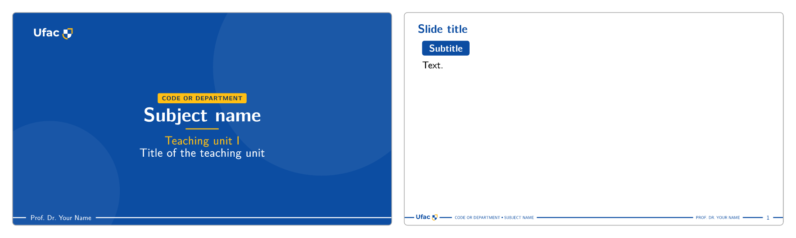
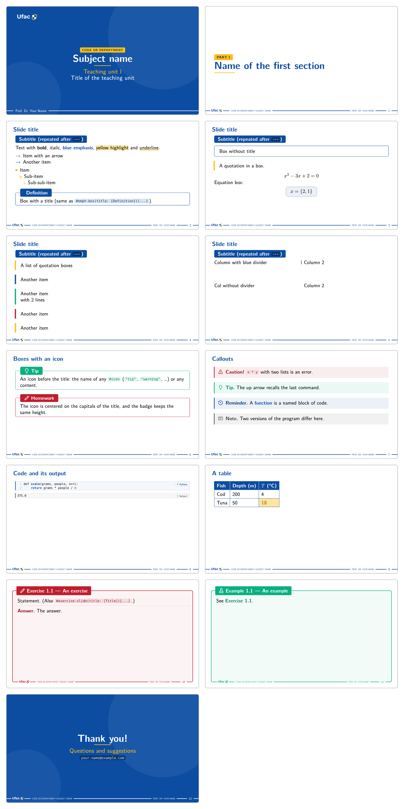

# touying-ufac-unofficial

<p align="center">
  <a href="https://typst.app/universe/package/touying-ufac-unofficial"></a>
  <a href="https://github.com/lucaslrodri/touying-ufac-unofficial/blob/v0.3.0/docs/manual.pdf"></a>
  <a href="https://typst.app/"></a>
  <a href="https://typst.app/universe/package/touying"></a>
  <a href="https://github.com/lucaslrodri/touying-ufac-unofficial/blob/v0.3.0/LICENSE"></a>
</p>

<p align="center">
  <em><a href="https://touying-typ.github.io/">Touying</a> slide theme in <a href="https://typst.app/">Typst</a> for the <a href="https://www.ufac.br/">Federal University of Acre (UFAC)</a>, Brazil.</em>
</p>

Slides with the look of UFAC for lectures, extension courses, coursework and final papers: a cover for each kind of work, section slides, exercises and examples in boxes, callouts and code blocks, in Portuguese, English or Spanish.

## Basic usage

```sh
typst init @preview/touying-ufac-unofficial:0.3.0
```

The command creates a deck from [template/main.typ](template/main.typ): the cover and one slide. In the new folder, `typst watch main.typ` compiles it on every change. Before a version reaches Typst Universe, its development version (the `develop` branch) can be installed as a local package and imported from `@local` instead of `@preview`.

The theme uses the font *New Computer Modern Sans*, which Typst does not bundle: without it, the slides fall back to another font. It belongs to the [New Computer Modern](https://ctan.org/pkg/newcomputermodern) family: download the archive from CTAN and take the `NewCMSans10-*.otf` files of its `otf` folder. Install them on the system, or keep them in a folder and compile with `typst watch --font-path <folder> main.typ`. In the [Typst web app](https://typst.app/), upload the `.otf` files to the project: fonts inside the project are found automatically.

<!-- template:begin (generated from template/main.typ by scripts/readme.sh: do not edit by hand) -->
````typst
// Starting deck for the touying-ufac-unofficial theme. Syntax: package README; the elements at a glance:
// example/main.typ; a whole lecture: example/lecture.typ, both at
// https://github.com/lucaslrodri/touying-ufac-unofficial/tree/v0.3.0/example
#import "@preview/touying:0.7.4": *
#import "@preview/touying-ufac-unofficial:0.3.0": *

#show: ufac-theme.with(
  aspect-ratio: "16-9",
  lang: "en",   // "pt-br" (default), "en" or "es"
  config-info(
    subject: [Subject name],                  // or Touying's `title:`
    subject-code: [CODE or Department],       // or `short-title:`
    unit-title: [Title of the teaching unit], // or `subtitle:`
    unit: [Teaching unit I],                  // or `short-subtitle:`
    author: [Prof. Dr. Your Name],
    counter-prefix: [1.],   // "Exercise 1.N"; none gives "Exercise N"
  ),
)

#title-slide()

== Slide title
=== Subtitle

Text.
````


<!-- template:end -->

`config-info` (Touying's) fills the cover and the footer:

| Field | Alias | What it is and where it goes |
| ----- | ----------------- | ---------------------------- |
| `title` | `subject` | the course or the work: large on the cover; footer, on the left ("CODE • TITLE") |
| `short-title` | `subject-code` | its code or a shorter name: the yellow tag of the cover; footer, before the title |
| `subtitle` | `unit-title` | the topic: on the cover |
| `short-subtitle` | `unit`, `course` | the lecture or the unit: on the cover, in yellow; `course` is the program, in a final paper |
| `author` | | one, an array or free content (`[_Advisor_ \ Name]`: lines and labels in emphasis): on the cover; footer, on the right (the first group) |
| `date` | `semester`, `year` | the date on the cover: `none`, `auto` (today), a `datetime` (written in full in the language of the deck) or a text; a `semester` or a `year` also goes to the footer |
| `institution` | | `auto` (the Universidade Federal do Acre) or an array; only for `#info` |
| `logo` | | the logos of the footer and of the cover, separated by dots: `auto` is the UFAC logo, `(auto, x)` adds `x` after it, `(x,)` replaces it and `none` removes them; a logo is content or `color => ...` (the color of the footer) |
| `contact` | | one or an array (an e-mail, a page); only for `#info`, such as in the body of `#ending-slide` |
| `counter-prefix` | | "Exercise 1.N" / "Example 1.N"; `[3.]` gives "Exercise 3.N", `none` gives "Exercise N", the default of the kinds without units (below) |

### The kind of work and the aliases

A deck of a course uses the aliases of the table above; giving one field under two names (`subject` and `title`) is an error. `kind` tells what the presentation is and brings the recommended cover and numbering; anything the deck sets itself wins:

| `kind` | Recommends |
| ------ | ---------- |
| `"lecture"` | the style `"line"`: the authors and the date on one line at the bottom |
| `"course"` (an extension course) | the style `"top"` and the label "Instructors" over the authors |
| `"talk"` | the style `"line"`; no units: exercises without a prefix ("Exercise 1") |
| `"coursework"` | the style `"stack"`: the authors in groups at the bottom left; no units: exercises without a prefix |
| `"tcc"`, `"dissertation"`, `"thesis"` | the style `"top"` and the tag of the work ("Undergraduate Thesis", …); no units: exercises without a prefix |

Without a `kind`, the cover has the style `"line"` and the exercises the prefix `[1.]`.

```typst
// the work of students for a course
config-info(
  kind: "coursework",
  subject: [Introduction to Economics],
  subject-code: [ECO101],
  unit-title: [The price of a cup of coffee in four cities],
  author: [_Students_ \ First Student, Second Student \ _Teacher_ \ Prof. Dr. Teacher Name],
  semester: [2026.1],
)

// a final paper
config-info(
  kind: "tcc",
  title: [A low-cost weather station for schools],
  course: [Bachelor's in Physics],
  author: [_Student_ \ Student Name \ _Advisor_ \ Prof. Dr. Advisor Name],
  year: 2026,
)
```

### Showing the information: `#info`

`#info` shows any field of the table but `counter-prefix`, or any alias, anywhere in a slide, inside boxes and tables too: `#info("subject")`, `#info("author")` (as written), `#info("date")` (in full), `#info("logo", height: 2em, white: true)`. With a function, it receives every field at once.

```typst
#emph-box(title: info("subject-code"))[
  #info("subject"), #info("semester"), taught by #info("author").
]
#info(i => [*#i.unit*: #i.unit-title.])

#ending-slide(subtitle: [Questions?])[#info("contact")]
```

### Options of the theme

`ufac-theme` takes: `aspect-ratio` (`"16-9"`, `"4-3"`, anything Touying's `utils.page-args-from-aspect-ratio` accepts), `lang` (`"pt-br"`, `"en"` or `"es"`), `background` of the cover and of the closing slide (`"circles"`, the default, `"gradient"` or `"plain"`), `exercise-name`, `example-name` and `part-name` (override the localized names), `exercise-icon` and `example-icon` (the icon on the badge of the exercise and example slides: the name of an icon, content or `none`; a pencil and a beaker by default), `footer-left` and `footer-right` (content or `self => ...`; each text of the footer stays on one line, cut with "…" when the two do not fit), `codly` (see [codly](#code-blocks-with-codly)) and `code-languages` (more languages for the code blocks, see [Code](#code)). Touying's configs go in the same call, as positional arguments: `config-info(..)`, `config-common(..)`, `config-page(..)`. `example-name` and `example-icon` change only the example slides: the callouts `#example` and `#examples` keep their own title and beaker, changed with their own `title:` and `icon:` (`#example(title: [Case.])[..]`).

## Example

[example/main.typ](https://github.com/lucaslrodri/touying-ufac-unofficial/blob/v0.3.0/example/main.typ) shows the elements of the [syntax](#syntax) in a short deck:

<!-- example:begin (generated from example/main.typ by scripts/readme.sh: do not edit by hand) -->
````typst
// Example deck of the touying-ufac-unofficial theme: the elements of the syntax at a glance (details: package README).
#import "@preview/touying:0.7.4": *
#import "@preview/touying-ufac-unofficial:0.3.0": *

#show: ufac-theme.with(
  aspect-ratio: "16-9",
  lang: "en",                         // "pt-br" (default), "en" or "es": text language and pill/section names
  // exercise-name: [Exercise], example-name: [Example], part-name: [Part],   // override the localized names
  config-info(
    subject: [Subject name],
    subject-code: [CODE or Department],
    unit-title: [Title of the teaching unit],
    unit: [Teaching unit I],
    author: [Prof. Dr. Your Name],
    counter-prefix: [1.],
  ),
)

#title-slide()

= Name of the first section
// Content right after `=` goes to the right of the section slide, at the page margin from the edge (usually an image):
// #image("figure.png")

== Slide title
=== Subtitle (repeated after `---`)

Text with *bold*, _italic_, ~~blue emphasis~~, ==yellow highlight== and ~underline~.

-> Item with an arrow
-> Another item

- Item
  - Sub-item
    - Sub-sub-item

> == Definition
> Box with a title (same as `#emph-box(title: [Definition])[...]`).

---

> Box without title

"A quotation in a box."


$
x^2 - 3x + 2 = 0
$

Equation box:

> $
x = {2, 1}
$

---

"A list of quotation boxes"
"Another item"
"Another item \
with 2 lines"
"Another item"
"Another item"


#cols(divider: true)[
  Column with blue divider
][
  Column 2
]

#v(3em)

#cols[Col without divider][Column 2]

== Boxes with an icon

#emph-box(color: colors.quaternary, icon: "tip", title: [Tip])[
  An icon before the title: the name of any `#icon` (`"tip"`, `"warning"`, …) or any content.
]

#emph-box(color: colors.tertiary, icon: "exercise", title: [Homework])[
  The icon is centered on the capitals of the title, and the badge keeps the same height.
]

== Callouts
// a caution (a mistake to avoid), a tip (a shortcut), a remark (to recall what was seen), a note (something
// secondary), an example and several examples (short, inside an ordinary slide): the color, the icon and the title in
// the language of the deck; `style: "badge"` gives the look of the boxes above
#caution[`x * y` with two lists is an error.]
#tip[The up arrow recalls the last command.]
#remark[A *function* is a named block of code.]
#note[Two versions of the program differ here.]
#cols[
  #example[`len([1, 2, 3])` is 3.]
][
  #examples[Types: `int`, `str`.]
]

== Code and its output
// the language in a pill at the top right; `text` (or `txt`, `output`) is the output of a program, in a gray box

```python
def scale(grams, people, n=4):
    return grams * people / n
```

```text
375.0
```

== A table
// the header row in blue; a cell filled with a light tone colors its bold text and chips like a box of that family

#table(
  columns: 3,
  table.header([Fish], [Depth (m)], [$T$ (°C)]),
  [Cod], [200], [4],
  [Tuna], [50], table.cell(fill: colors.secondary-lighter)[*18*],
)

== An exercise <exercise-a>

Statement. (Also `#exercise-slide(title: [Title])[...]`.)

// alone on a line, `#answer` opens the answer with "Answer."; `#solution` in an example
#answer
The answer.

== An example <example>

See @exercise-a.

// `sep:` gives another separator after the word: "Solution:"
#solution(sep: ":")
The solution.

// closing slide: the blue page of the cover with the footer in white; `#ending-slide()` alone says "Thank you!"; the
// contact of `config-info(contact:)`, when there is one, goes in the body: `#info("contact")`
#ending-slide[Thank you!][Questions and suggestions][`your.name@example.com`]
````


<!-- example:end -->

The deck above as a PDF: [main.pdf](https://github.com/lucaslrodri/touying-ufac-unofficial/blob/v0.3.0/docs/decks/main.pdf). More example decks, for other kinds of presentation, with the PDF of each one:

- [lecture](https://github.com/lucaslrodri/touying-ufac-unofficial/blob/v0.3.0/example/lecture.typ) ([PDF](https://github.com/lucaslrodri/touying-ufac-unofficial/blob/v0.3.0/docs/decks/lecture.pdf)): a lecture of a course, with the aliases of a course, an outline, exercises and examples with their solutions, code and callouts.
- [course](https://github.com/lucaslrodri/touying-ufac-unofficial/blob/v0.3.0/example/course.typ) ([PDF](https://github.com/lucaslrodri/touying-ufac-unofficial/blob/v0.3.0/docs/decks/course.pdf)): an extension course, with several instructors, the `"gradient"` background and code through codly 2 (Typst ≥ 0.15).
- [tcc](https://github.com/lucaslrodri/touying-ufac-unofficial/blob/v0.3.0/example/tcc.typ) ([PDF](https://github.com/lucaslrodri/touying-ufac-unofficial/blob/v0.3.0/docs/decks/tcc.pdf)): the defense of a final paper, with the student and the advisors under labels on the cover and the `"plain"` background.
- [coursework](https://github.com/lucaslrodri/touying-ufac-unofficial/blob/v0.3.0/example/coursework.typ) ([PDF](https://github.com/lucaslrodri/touying-ufac-unofficial/blob/v0.3.0/docs/decks/coursework.pdf)): a paper for a course, with the students and the teacher in groups on the cover (the style `"stack"`).

## Syntax

### Headings and slide breaks

| Markup                          | Effect                                                                                       |
| ------------------------------- | -------------------------------------------------------------------------------------------- |
| `= Title` + `#image(...)`       | Section slide: the title under "PART N" in a yellow tag (`PARTE` in Portuguese and Spanish); the content right after `=` sits on the right, one page margin away from the edge, in a frame of 12em × 66% of the height of the content area: an image without a size fills it, one with a size keeps it and shrinks when it is larger than the frame (never cropped or stretched) |
| `== Title`                      | New slide with a blue header                                                                 |
| `== Title <exercise>`           | Exercise slide: a red box filling the slide, "Exercise 1.N — Title" (`Exercício`/`Ejercicio`) on a badge with a pencil, the footer closing the box; numbered automatically; `<exercise-id>` makes it citable with `@exercise-id` |
| `== Title <example>`            | Example slide: the same in green, with a beaker, "Example 1.N — Title" (`Exemplo`/`Ejemplo`), independent counter; `<example-id>` likewise; a short example inside an ordinary slide is the callout `#example[...]` |
| `#solution`, `#answer`          | Alone on a line, inside an example or an exercise (outside, nothing): a dashed line, then "Solution." / "Answer." in bold before the text that follows; with a `#pause` before or after the marker, the solution appears on the next subslide; `#answer(sep: ":")` or `#solution(sep: [:\ ])` for a separator other than the period |
| `=== Subtitle`                  | Pill in the color of the box around it (blue on a slide), no new slide; repeated at the top of every continuation and overflow page |
| `==== Subtitle`                 | Same pill, not repeated                                                                      |
| `---` (alone on a line), `#pagebreak()` | Next page of the same slide (same header; in an exercise or example, the same box and number); a long content also goes on by itself |
| `==` (without text)            | A slide without a title, with the footer |

Touying breaks the page at a top-level em dash next to inline markup, so `Text — *bold*` starts a new page: use an en dash (`–`) or put the paragraph in a `#block[ ]` (a plain `#[ ]` does not protect it).

Functions: `#title-slide()` (`style:` `"line"`, `"stack"` or `"top"`; `header-left` … `footer-right` change each position; `#title-slide[...]` puts content below the titles: a message, a contact, a logo), `#outline()` (the parts of the deck, each a link to its section slide), `#slide[...]`, `#ending-slide[title][subtitle][body]` (the closing slide, on the blue page of the cover; without a title, "Thank you!"), `#exercise-slide(title:, color:, icon:)[...]`, `#example-slide(title:, color:, icon:)[...]`.

### Inline formatting

| Markup                     | Result                                                                                   |
| -------------------------- | ---------------------------------------------------------------------------------------- |
| `*text*` / `_text_`        | black bold / black italic (bold takes the box color inside a box, white inside pills) |
| `#alert[text]`, `~~text~~` | blue bold (the box color inside a box, UFAC yellow inside pills)                         |
| `==text==`, `#highlight[...]` | light-yellow background (`#highlight(fill: colors.quaternary-lighter)` for other tones) |
| `~text~`, `#underline[...]` | strong yellow underline (box color inside a box)                                   |
| `#primary`, `#secondary`, `#tertiary`, `#quaternary` | bold text in blue / yellow / red / green                       |
| `` `code` ``               | gray chip; inside titles, boxes, pills and table cells it follows the container color (inverted in the blue header and in cells of a dark palette tone, light tones in cells of a light one) |
| `#tag[text]`               | the yellow tag of the cover, for the text, the titles and the tables; `color:` for another one |
| `#icon("tip")`             | an icon on the line, in the color of its surroundings (see [Icons](#icons)) |

Escapes: `\==x==`, `\> text`, `-\> item`, `\~text\~`, `\"quote\"`. No shorthand is applied inside `raw`.

### Lists and terms

| Markup                                  | Result                                                    |
| --------------------------------------- | --------------------------------------------------------- |
| `-> item` (start of a paragraph)        | list with a blue `→` marker (`#arrows(color:)[...]` recolors it) |
| `- item` / `  - sub` / `    - sub`      | yellow filled square / rotated hollow square / small circle |
| `+ item` / `  + sub` / `    + sub`      | `1.` / `a)` / `i.`, blue and bold; `#set enum(numbering: "a)")` starts at `a)` |
| `/ Term: description`                   | bold term, colon, line break                              |

### Boxes, quotes and columns

```typst
#emph-box[...]                                        // thin blue border; `color:` for another family
#emph-box(color: colors.quaternary, title: [Title])[...]   // badge over the top border
#emph-box(color: colors.tertiary, icon: "exercise", title: [Homework])[...]   // icon before the title (name or content)
$ #eq-box[$E = m c^2$] $                              // equation box, inside the equation (`color:` optional)
#caution[...]                                         // a mistake to avoid, red; #tip (a shortcut), #remark (to recall what was seen), #note (something secondary)
#example[...]                                         // a short example, green with a beaker; #examples[...] for several
#callout("tip", style: "badge")[...]                  // the same callouts by kind; style: "badge" for the emph-box look, title: [Shortcut.] for another title, with its punctuation
#quote-box(color: colors.secondary)[...]              // vertical bar on the left
#cols(divider: true, columns: (1fr, 2fr))[A][B]       // Touying's cols, optional blue divider
```

Markdown-like short forms (inline content only; the boxes in the primary color, the quotes cycling yellow, blue, green and red):

```
> Box without title.

> == Title
> Box with title.

> $ E = m c^2 $         // `>` before a block equation (same line or the line above): equation box

"A quotation."          // paragraph made only of quoted lines → one quote box per line
```

### Figures

A caption shows its body only, without "Figure N", at 0.6 of the size of the text; `#show figure.caption: set text(size: 18pt)`, after `#show: ufac-theme.with(..)`, gives another size. A large image, such as a photo, needs a height, or its caption can run into the footer: `#figure(image("photo.jpg", height: 60%), caption: [...])`, where 60% of the slide leaves room for a line or two of text above it. A reference to a figure (`@label`) says "Figure 1" in the language of the deck, a number the slide does not show (the figure of a section counts too): cite a figure in words.

### Code

A code block goes in the box of the theme, with the line numbers and the language in a pill: `python` (`py`), `typst` (`typ`), `matlab`, `bash` and `sh`; `ufac-theme(code-languages:)` adds others, as `(name:, icon:)`. The output of a program, a block in `text` (or `txt`, `output`), goes in a gray box with its own pill ("Output", in the language of the deck); the [example](#example) shows both. A long block goes on to the next page of the slide, as any long content (a callout in the default style does not split: a long listing goes outside it). For a file name, highlights or ranges, use [codly](#code-blocks-with-codly).

````typst
#show: ufac-theme.with(
  code-languages: (c: (name: "C", icon: "code")),   // the name in the pill and an icon (or none)
  config-info(subject: [Programming]),
)

```c
int main(void) { return 0; }
```
````

### Colors

`colors` has five families (`primary` `#0C4DA2`, `secondary` `#FFBF14`, `tertiary` `#BE1E2D`, `quaternary` `#09B081`, `neutral` `#808080`) × seven tones (`-darkest`, `-darker`, `-dark`, base, `-light`, `-lighter`, `-lightest`), e.g. `colors.primary-lighter`. The same keys are available as `self.colors.*`.

## Integrations

The theme sits on Touying and works with the packages a deck usually takes along. It exports short names that other packages also use, such as `example`, `remark` and `solution` of theorion: with two imports with `*`, the later one wins silently, so import the other package by its name (`#import "@preview/theorion:0.3.3" as theorion`, then `#theorion.example[..]`).

### Touying

Touying's `#pause`, `#uncover`, `#only`, `#alternatives`, `#speaker-note`, `#slide(composer:)` etc. work as usual, on every element of the theme; covered content stays faintly visible under a veil in the color of the page. So do the packages Touying integrates: [CeTZ](https://touying-typ.github.io/docs/integration/cetz) and [Fletcher](https://touying-typ.github.io/docs/integration/fletcher) (whose diagrams reveal their parts with `#pause` through `touying-reduce`), [pinit](https://touying-typ.github.io/docs/integration/pinit) and [MiTeX](https://touying-typ.github.io/docs/integration/mitex).

### Code blocks with codly

The theme draws its own code box and does not need [codly](https://typst.app/universe/package/codly). For codly's features (a file name, highlights, ranges, `diff`), import codly 2 (Typst ≥ 0.15) and pass it to the theme: every block goes through codly with the same look. The languages of the codly-languages package can be given to `ufac-theme(code-languages:)`.

````typst
#import "@preview/codly:2.0.0" as codly
#show: ufac-theme.with(codly: codly, config-info(subject: [Ocean Science]))

#codly.new(
  ```python
  def scale(grams, people, n=4):
      return grams * people / n
  ```,
  file: "recipe.py",
  highlights: ((line: 2, start: 12, end: 26, tag: [per person]),),
)
````

### Icons

`#icon("name", color: auto, size: 1em)` draws an icon on the line of text, in the color of its surroundings: black in the text, the color of a box inside it, white in a pill. The theme ships only the icons it uses, each with a role that is also its name (`"caution"`, `"tip"`, `"remark"`, `"note"`, `"exercise"`, `"example"`, `"python"`, …; the full list is in the [manual](https://github.com/lucaslrodri/touying-ufac-unofficial/blob/v0.3.0/docs/manual.pdf), with a picture of each). Any other icon comes from a collection in the JSON format of [Iconify](https://iconify.design/): give it to `provide-icons` and write the icon as `"collection:name"`, in `#icon` or wherever the theme takes an icon (an `emph-box`, a callout, the badge of an exercise or example), where it behaves like an icon of the theme.

```typst
== Field trip
// only the chosen icons, from https://api.iconify.design/ph.json?icons=boat-bold,sun-bold,waves-bold
#provide-icons(json("ph.json"))
#emph-box(icon: "ph:boat-bold", title: [On the boat])[
  Bring a hat #icon("ph:sun-bold") and water.
]
#tip(icon: "ph:waves-bold")[The tide turns at 14:20.]

#exercise-slide(title: [Wave height], icon: "ph:waves-bold")[Measure the height of ten waves.]
```

The names of the icons are on [icones.js.org](https://icones.js.org/); a whole collection can also be downloaded from the [site of the iconify package](https://ecstrema.github.io/iconify-typst). Each collection has its own license.

## Documentation

The [manual (PDF)](https://github.com/lucaslrodri/touying-ufac-unofficial/blob/v0.3.0/docs/manual.pdf) goes from the first deck to every detail, with an example next to each feature, then the migration from 0.2.0, the reference of every function and an index.

## Dependencies

| Dependency | Version | Role |
| ---------- | ------- | ---- |
| [Typst](https://typst.app/) | ≥ 0.14 | compiler |
| [touying](https://typst.app/universe/package/touying) | 0.7.4 | slide engine (the deck imports it too) |
| [iconify](https://typst.app/universe/package/iconify) | 0.5.3 | the icons of a collection the deck gives to `provide-icons` (see [Icons](#icons)); the theme's own icons are shipped with the theme |
| [codly](https://typst.app/universe/package/codly) | 2.0.0 | optional: the code blocks through codly (Typst ≥ 0.15); see [codly](#code-blocks-with-codly) |
| *New Computer Modern Sans* | | font, not bundled with Typst, unlike *New Computer Modern Math*, used for the equations (see [Basic usage](#basic-usage)) |

The packages are fetched automatically; the theme imports touying and iconify, and a deck imports codly when it wants it. The font is not fetched.

## License

The theme is licensed under the [MIT License](LICENSE). The contents of [template/](template/) are licensed under [MIT No Attribution](LICENSE-MIT-0) (MIT-0), so a deck created from the template can be used and shared without restriction, with no attribution required.

Third-party components: the icons in [assets/icons/](assets/icons/) come from [Octicons](https://primer.style/octicons/) (© GitHub Inc., MIT License), [Phosphor](https://phosphoricons.com/) (MIT License), [Devicon](https://devicon.dev/) (MIT License), [Simple Icons](https://simpleicons.org/) (CC0), [Material Icon Theme](https://github.com/material-extensions/vscode-material-icon-theme) (MIT License) and [VSCode Icons](https://github.com/vscode-icons/vscode-icons) (MIT License), in the format of [Iconify](https://iconify.design/).

The UFAC logo ([assets/ufac-logo.svg](assets/ufac-logo.svg)) is the property of the [Federal University of Acre](https://www.ufac.br/), and the theme is meant for academic use. This theme is unofficial: it is not affiliated with or endorsed by the university.

## Changelog

### 0.3.0

Breaking changes, and how to move a 0.2.0 deck:

- The information of the deck is Touying's `config-info`: keep `subject` and `subject-code`, now aliases of `title` and `short-title`; rename the old `title` to `unit-title` (or `subtitle`) and the old `subtitle` to `unit` (or `short-subtitle`), since `subject` and `title` together are an error; `ufac-theme(logos: ..)` → `config-info(logo: ..)`. A function of `footer-left` or `footer-right` reads Touying's names, `self.info.title` and `self.info.short-title` (`self.info.subject` is gone), or the footer is content with `#info("subject")`.
- `<empty-slide>`, `<empty-slide-COLOR>` and the theme's `#empty-slide` are removed: the theme has no empty slide of its own. A label `<empty-slide…>` is now an ordinary label, so the slide becomes an ordinary one, with its header: look for these labels in the deck. The blue page of the cover, with the footer, is the new `#ending-slide(title: none)[...]`; a page without header or footer is Touying's `#empty-slide[...]` (the deck imports Touying), which takes neither `color:` nor `title:`: for another color, `#empty-slide(config: config-page(fill: colors.tertiary))[#set text(fill: white); ...]`. A `==` without text gives a slide without a title, with the footer.
- The theme no longer depends on codly or linguify: the functions of codly 1 it exported (`codly`, `local`, `codly-range`, `no-codly`, …) are gone. The theme's own code box goes on to the next page by itself, so `#local(breakable: true)` is not needed; to keep codly, use codly 2 (Typst ≥ 0.15): `#import "@preview/codly:2.0.0" as codly` and `ufac-theme(codly: codly)`.
- The theme ships only its own icons: `#icon("rocket")` of 0.2.0 needs the Octicons collection, `#provide-icons(json("octicon.json"))`, and `#icon("octicon:rocket-16")` (see [Icons](#icons)); the Octicons the theme ships keep their own names (`"alert"`, `"pencil"`, `"beaker"`, …).
- The content of the section slides keeps the page margin by default, and the margin is the `margin` of `new-section-slide`, no longer `ufac-theme(section-margin:)`: for the old look, `config-common(new-section-slide-fn: new-section-slide.with(margin: 0pt))`.
- The theme exports new names: `caution`, `tip`, `remark`, `note`, `example`, `examples`, `solution`, `answer`, `info` and `tag`. A package imported with `*` before the theme loses those it shares, such as theorion's `example`, `remark` and `solution`: import it by its name (see [Integrations](#integrations)).
- `ufac-logo-image` is gone: in a slide, `#info("logo", height: 2em)` (`white: true` on a dark background); outside a deck, as in a handout, `#image(bytes(ufac-logo), height: 2em)`.
- Figure captions are at 0.6 of the size of the text: a deck that made them smaller by hand with a size in `em` removes that, or they get smaller twice; `#show figure.caption: set text(size: 18pt)`, after `#show: ufac-theme.with(..)`, gives another size.

New:

- A new cover, with three styles (`"line"`, `"stack"`, `"top"`), six positions, the tag and the rule, and three backgrounds (`background:`); the section slide follows it.
- Aliases of a course (`subject`, `semester`, …), `kind`, authors as free content with labels, `date`, `institution`, `contact` and `#info`.
- Exercises and examples in a box filling the slide, as in a printed handout: the solution with `#solution` / `#answer`, over several pages.
- Callouts: `#caution`, `#tip`, `#remark`, `#note`, `#example`, `#examples`, or `#callout(kind)`.
- `#tag`, the yellow tag of the cover, for the text, the titles and the tables.
- The code blocks in a box of their own, with the language and its logo, which go on to the next page when they are long; `code-languages` adds languages, and the output has its pill in the language of the deck.
- The texts of the footer stay on one line, cut with "…" when they do not fit, and a long content keeps the repeated `===` pill without running into the footer.
- `provide-icons` gives the deck the icons of any collection of Iconify.
- Inside a box, the alert, the subtitles and the links follow its color too (a reference to an exercise or example keeps the color of its kind); a slide whose content is only a shorthand (`-> item`, `> box`) is now rewritten too.
- Figure captions are at 0.6 of the size of the text, which leaves more room for the figure.
- The figure of a section fits whole in a frame of 12em × 66% of the height, neither cropped nor stretched: an image without a size fills it, one with a size shrinks when it is larger than the frame.
- Four more example decks: [lecture](https://github.com/lucaslrodri/touying-ufac-unofficial/blob/v0.3.0/example/lecture.typ), [course](https://github.com/lucaslrodri/touying-ufac-unofficial/blob/v0.3.0/example/course.typ), [tcc](https://github.com/lucaslrodri/touying-ufac-unofficial/blob/v0.3.0/example/tcc.typ) and [coursework](https://github.com/lucaslrodri/touying-ufac-unofficial/blob/v0.3.0/example/coursework.typ).

### 0.2.0

- Closing and transition slides: `<empty-slide>`, `<empty-slide-primary>`, … or `#empty-slide`.
- Icons in the exercise and example pills and in `emph-box`.
- Content below the cover titles (`#title-slide[...]`) and `#outline()`.
- More than one logo (`logos`) and the margin of the section slides (`section-margin`).
- `ufac-logo-image`: the UFAC logo in other colors.
- Code blocks that split across pages (`#local(breakable: true)`).
- Code in table cells follows the cell color.
- The manual is a single document; the example deck is no longer shipped in the package.

### 0.1.0

- First release on Typst Universe: theme, cover, section slides, exercise and example slides, boxes, quotes, columns, icons, code blocks (codly), template and manual.
